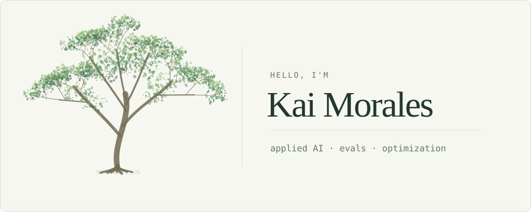

  <picture>
    <source media="(prefers-color-scheme: dark)" srcset="tree-dark.svg">
    
  </picture>

I’m Kai, an Applied AI Intern at Tesla. I’m interested in AI engineering, evaluation, and optimization. I also make things for sports and the web, usually because I wanted to understand something better.

[portfolio](https://kmurakami.com) · [projects](https://kmurakami.com/projects.html) · [experience](https://kmurakami.com/experience.html) · [LinkedIn](https://www.linkedin.com/in/kaimorales)

The tree is a still frame inspired by the one that grows into my [portfolio](https://kmurakami.com).
